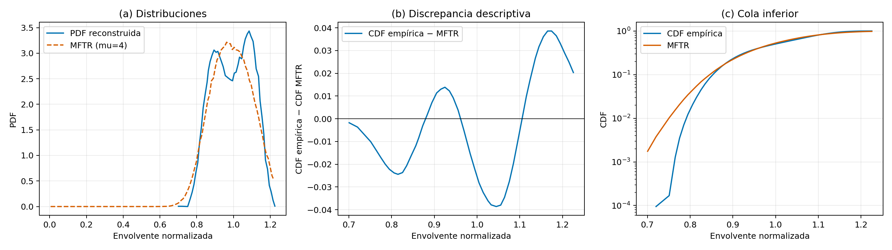
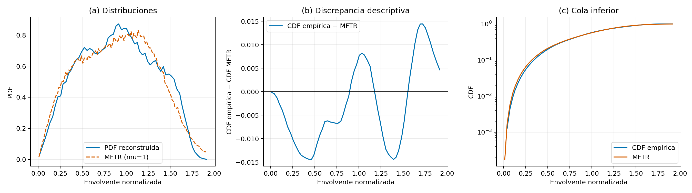
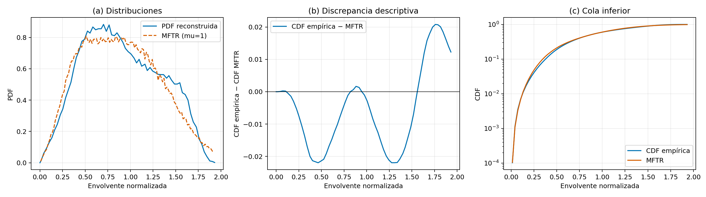
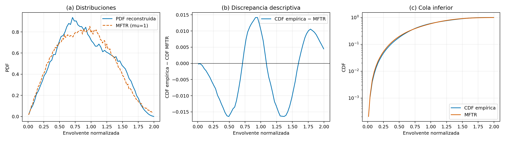
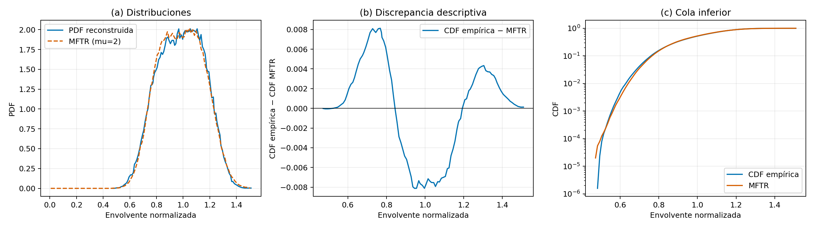
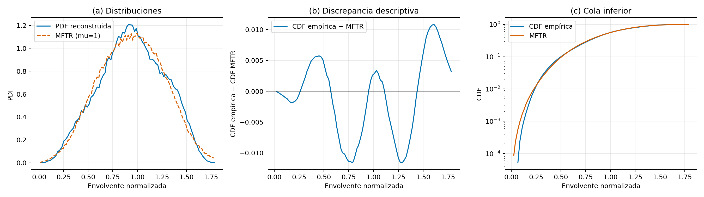

# Ajuste descriptivo del residuo THz–MFTR

## Alcance y configuración

Este análisis ajusta una CDF MFTR a las densidades tabuladas en los seis CSV existentes. La densidad entre coordenadas se interpreta como lineal y nula fuera del soporte tabulado; se normaliza el segundo momento a $\Omega=1$. La función objetivo es $D_{KS}=\max_x|F_{CSV}(x)-F_{MFTR}(x)|$ sobre las coordenadas suministradas. Para construir la CDF se usó integración trapezoidal, que integra exactamente la densidad lineal asumida entre puntos; la regla `cumsum(pdf*gradient(x))` de la guía se calculó solo como comprobación secundaria.

El submodelo evaluado está restringido a:

- $K\in[0,50]$
- $\Delta\in[0,1]$
- $m\in[0.1,60]$
- $\mu\in\{1,2,3,4,5\}$
- $\Omega=1$.

$\mu$ se ajustó en la grilla entera solicitada, como conteo de clústeres en esta construcción; no se redondearon propuestas continuas. Las restricciones hacen el ajuste reproducible y acotado, pero no permiten concluir que el MFTR completo, con parámetros fuera de esos rangos, sea el modelo que mejor describe los datos. Ajustes históricos con $K$ o $m$ mayores se conservan como contexto y no se mezclan con este objetivo.

Además, la envolvente no necesariamente identifica $K$ y $\Delta$ por separado: combinaciones distintas pueden producir curvas similares. Por eso los valores de la tabla se interpretan como parámetros efectivos del mejor candidato encontrado dentro de este submodelo, no como mediciones físicas independientes de potencia por rayo.

Las evaluaciones usan 200.000 muestras MFTR, semilla de simulación 4242, differential evolution con `popsize=15`, sin polishing y hasta 40 iteraciones en la corrida inicial. Tres semillas nuevas cuantifican la variación Monte Carlo del candidato; no cuantifican incertidumbre de medición.

### Por qué el muestreador difiere de la receta inicial

La receta inicial era un punto de partida y advertía que había que verificar la ley de fluctuación y el reparto de potencia. Las ecuaciones (5), (7)–(9) del [artículo MFTR](https://arxiv.org/pdf/2212.02448) llevan a tres correcciones necesarias antes de comparar curvas:

1. **La fluctuación $\zeta$ multiplica potencia.** El artículo define $\zeta\sim\operatorname{Gamma}(m,1/m)$ como factor de potencia, por lo que la amplitud especular se multiplica por $\sqrt{\zeta}$. Multiplicarla directamente por $\zeta$ haría que su potencia dependiera de $\zeta^2$, cuya media es $1+1/m$, y cambiaría la forma de la distribución. Normalizar después cada lote no corrige ese error de forma.
2. **$K$ se define sobre toda la potencia especular de los $\mu$ clústeres.** Con $S=V_1^2+V_2^2+\sum_{i=2}^{\mu}U_i^2$, el artículo define $K=S/(2\sigma^2\mu)$ y $\Delta=2V_1V_2/S$. En la receta inicial el primer par recibía $P=2\sigma^2K$ y luego se añadía potencia $P/\mu$ en cada clúster restante. Para $\mu>1$, eso da $S=P(2-1/\mu)$ en vez de $S=2\sigma^2\mu K$; por tanto, el $K$ realmente simulado ya no era el parámetro de entrada. La versión corregida fija $P=2\sigma^2\mu K$ y elige $V_1,V_2$ de modo que $V_1^2+V_2^2=P$ y $2V_1V_2=\Delta P$.
3. **Se asigna la parte especular al primer clúster ($U_i=0$ para $i\ge2$) por equivalencia de la envolvente marginal.** Condicionados a la fluctuación compartida y a la fase relativa, los $2\mu$ componentes gaussianos isotrópicos hacen que la potencia total dependa del vector especular solo por su longitud al cuadrado, $\zeta S(1+\Delta\cos\theta)$. Así, cualquier reparto con el mismo $S$ y $\Delta$ genera la misma distribución marginal de envolvente bajo los supuestos MFTR. Los clústeres difusos restantes no se eliminan: su suma se genera exactamente como una Gamma de forma $\mu-1$ y escala 2, equivalente a sumar sus $2(\mu-1)$ componentes gaussianas al cuadrado. La construcción no conserva la estructura física por clúster ni permite inferir ganancias, ángulos o retardos del PADP.

También se reemplazó la normalización por la media de potencia observada en cada lote por la normalización teórica $\Omega=2\mu\sigma^2(1+K)$. La constante teórica mantiene las realizaciones independientes y de potencia media unitaria; la media muestral debe fluctuar alrededor de uno.

### Qué significa la semilla 5252

Se usan dos generadores aleatorios distintos. La **semilla de simulación 4242** fija las realizaciones MFTR con las que se evalúa cada combinación de parámetros. La **semilla del optimizador** fija la población inicial y las decisiones aleatorias de differential evolution. En la corrida baseline ambas semillas eran 4242, que es el comportamiento original. Como los candidatos no convergieron dentro del límite inicial, se volvió a iniciar cada búsqueda desde una nueva población, manteniendo la simulación en 4242, cambiando la semilla del optimizador a **5252** y aumentando el máximo de 40 a 80 iteraciones. No fue una continuación de la población baseline.

Por tanto, 5252 no es un parámetro MFTR, un número de muestras ni un umbral estadístico: es un valor arbitrario, elegido como semilla distinta y reproducible para que la búsqueda explore otra trayectoria. “Baseline” nombra la primera corrida de referencia; “revisión” nombra esa repetición con otra trayectoria de búsqueda y más iteraciones. Mantener fija la semilla de simulación hace comparables las discrepancias de ambas búsquedas; las semillas 4243, 4244 y 4245 se usan después para medir sensibilidad Monte Carlo del candidato elegido. Entre baseline y revisión se eligió, por escenario, el candidato con menor discrepancia en ese mismo objetivo. La revisión con 5252 ganó en los seis escenarios, aunque los seis candidatos seleccionados todavía agotaron las 80 iteraciones sin converger.

## Verificación de los datos

Se revisaron los seis CSV: las coordenadas son finitas, no negativas, están ordenadas y no tienen duplicados ni densidades contradictorias. El área y el segundo momento son compatibles con las curvas normalizadas. Se usaron los CSV como fuente de ajuste y se conservaron sin cambios. La comprobación con los MAT no mostró una discrepancia que afecte los CSV; las incidencias históricas de MATLAB en los escenarios 5 y 6 se anotan únicamente como contexto.

## Resultados del ajuste

Los seis parámetros seleccionados son los de menor discrepancia observada entre las dos corridas. Ninguno convergió en las 80 iteraciones de revisión, por lo que son los mejores candidatos de las corridas realizadas, no óptimos globales certificados. Los escenarios 1 y 5 además quedan cerca de las fronteras de `K` y `m`, respectivamente, y deben tratarse como inciertos.

| Escenario | K | Δ | m | μ | Convergencia | Frontera cercana |
|---|---:|---:|---:|---:|---|---|
| 1 | 49.9921 | 0.2330 | 58.8500 | 4 | No converge | K máximo |
| 2 | 6.7312 | 0.9819 | 22.1203 | 1 | No converge | — |
| 3 | 20.4817 | 0.9092 | 4.0403 | 1 | No converge | — |
| 4 | 6.9015 | 0.9304 | 8.2119 | 1 | No converge | — |
| 5 | 43.6784 | 0.3895 | 59.6138 | 2 | No converge | m máximo |
| 6 | 8.2461 | 0.6824 | 50.2546 | 1 | No converge | — |

| Escenario | `D_KS` | Picos* | `xi` de máxima separación | Percentil | `N_min` hipotético | `D_KS` con semillas frescas (mín.–máx.) |
|---|---:|---:|---:|---:|---:|---:|
| 1 | 0.038605 | 4 | 1.044967 | 62.72 | 1,241.1 | 0.038985–0.040325 |
| 2 | 0.014425 | 9 | 1.393911 | 84.75 | 8,888.3 | 0.014555–0.016115 |
| 3 | 0.021971 | 10 | 0.463922 | 16.03 | 3,831.6 | 0.022748–0.023563 |
| 4 | 0.016427 | 7 | 0.493452 | 17.60 | 6,854.5 | 0.016724–0.018522 |
| 5 | 0.008119 | 12 | 0.767978 | 11.23 | 28,062.1 | 0.007968–0.009564 |
| 6 | 0.011601 | 10 | 1.289740 | 83.12 | 13,742.7 | 0.012414–0.013636 |

\* El conteo de picos usa el umbral descriptivo de altura del 15% del pico máximo indicado en la tarea. Depende de la digitalización y no es, por sí solo, evidencia de modos físicos ni de significancia.

La tabla y las figuras usan la CDF integrada por trapecios.

`N_min=(1.36/D_KS)^2` es solo una sensibilidad hipotética bajo el umbral clásico de una prueba KS de dos muestras y sus supuestos. No equivale al número de trayectos detectados ni constituye una prueba de significancia para estas curvas tabuladas. La multimodalidad, la forma sistemática del residuo y el tamaño `N_min` tampoco demuestran significancia sin el diseño de adquisición, las observaciones independientes y una calibración adecuada.

## Figuras principales

En cada figura, el panel (a) compara la PDF tabulada con la PDF simulada del candidato seleccionado; (b) muestra la diferencia entre las CDF por trapecios; (c) amplía la cola inferior. Las figuras enlazan los PNG de la corrida de revisión conservados en `results/`.

### Escenario 1

### Escenario 2

### Escenario 3

### Escenario 4

### Escenario 5

### Escenario 6

Los originales CSV no se modificaron.

## Limitaciones y siguiente etapa

No se generan muestras a partir de las PDF empíricas. El soporte finito y la masa de cola no observada se tratan como cero fuera de la tabla. El ajuste es descriptivo; las semillas nuevas solo miden ruido Monte Carlo del simulador. La convergencia del optimizador, estabilidad entre semillas, incertidumbre de fuente y significancia son cuestiones separadas. No se ejecutó bootstrap experimental porque faltan PADP y una calibración definida. No se entrenó GAN ni se modificaron checkpoints.

El análisis no permite inferir las ganancias por trayecto ni la geometría de los seis escenarios; para esa etapa se preparó por separado un borrador de solicitud de los PADP y sus metadatos.
